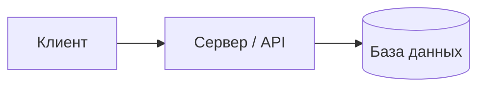

# Архитектура системы

## Схема

Вставь схему компонентов (изображение или Mermaid-диаграмму):

## Компоненты

| Компонент | Назначение | Технология |
|---|---|---|
| … | … | … |

## Модель данных

Основные сущности и связи между ними (ER-диаграмма или таблица).

## Ключевые решения

Почему выбрана именно такая архитектура; какие альтернативы рассматривались.
